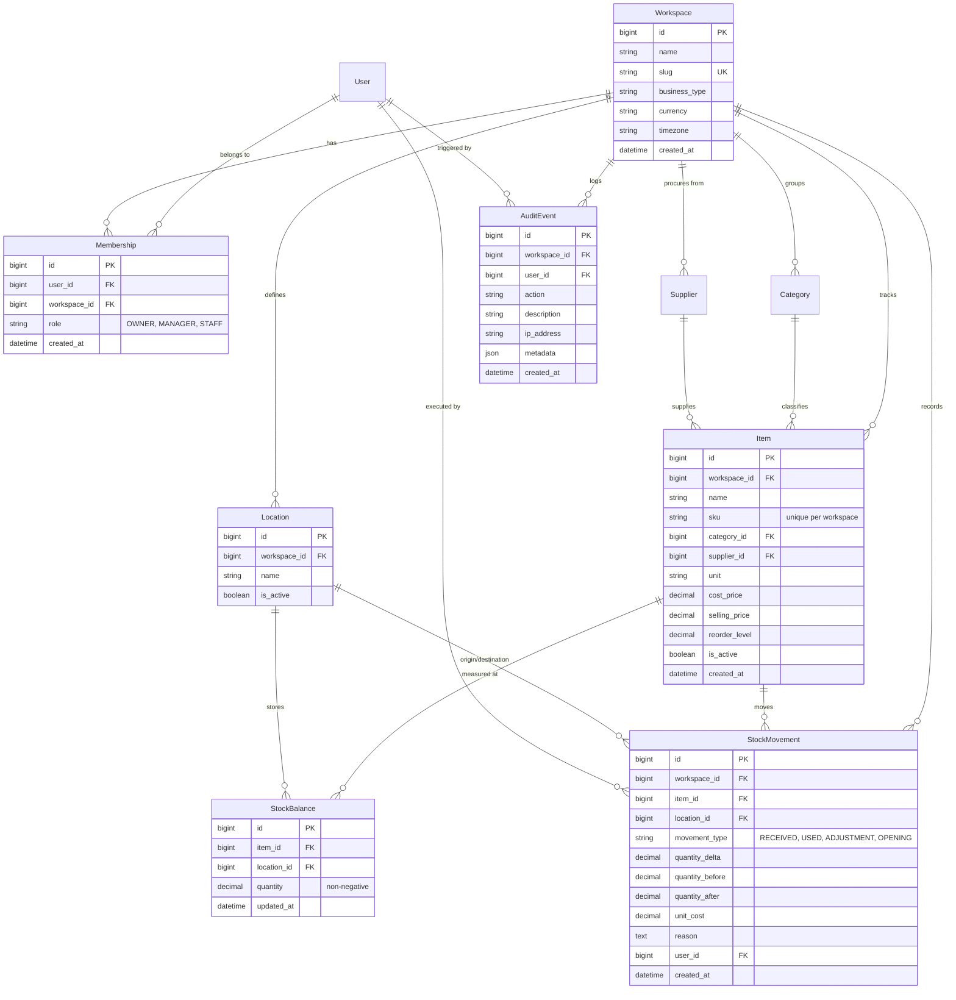

# Itwadura Inventory - Architecture & Data Model

## 1. Overview & Core Philosophy

**Itwadura Inventory** is a modular monolith built on Django, PostgreSQL (with SQLite for local development), server-rendered templates, and HTMX. The design follows one fundamental operational premise:

> **"Know what you have, where it is, and when to restock."**

All physical stock changes are modeled as **immutable movement events**. Application forms never directly update balances; all balance modifications flow through a transactional service with row-level locking.

---

## 2. Entity Relationship Diagram (ERD)



---

## 3. Key Stock Consistency Rules

1. **Immutable History:**
   Stock movements are append-only. There is no edit or delete operation for a `StockMovement`. Any discrepancy is reconciled by posting an `ADJUSTMENT` movement with an audited reason.

2. **Atomic Execution & Row-Level Locking:**
   All inventory modifications run inside `transaction.atomic()`. The target `StockBalance` row is locked using `select_for_update()` before calculating adjustments:
   ```python
   balance, _ = StockBalance.objects.select_for_update().get_or_create(
       workspace=workspace, item=item, location=location
   )
   ```
   This prevents race conditions and phantom updates during concurrent sales or deliveries.

3. **Non-Negative Balance Invariant:**
   By default, inventory cannot drop below zero. If an operation would cause `quantity_after < 0`, the transaction aborts with a descriptive validation error.

4. **Multi-Tenant Isolation:**
   Every query is filtered by `workspace`. Uniqueness constraints (such as `(workspace, sku)`) and model validation guarantee that tenant data remains completely isolated.

5. **Low Stock Definition:**
   An item is marked **Low Stock** when:
   $$\text{Total On-Hand Quantity} \le \text{reorder\_level} \quad \text{and} \quad \text{reorder\_level} > 0$$

